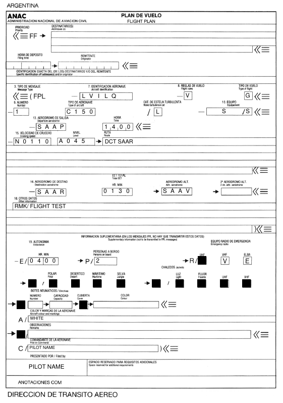

# FPL-Service

Small Python service that fills the Argentine ANAC/ICAO flight plan form (FPL) from JSON and returns a print-ready, flattened PDF.

Filling this form by hand is repetitive and easy to get wrong. Item 19 (supplementary information) is the tricky part: equipment you *don't* carry has to be crossed out, and a group letter (S, J, D) is crossed out only when every item in that group is absent. The service does that automatically.



*Output for [`examples/flight_plan.json`](examples/flight_plan.json).*

## What it does

- Writes each value aligned to its box on the official form template (`FPL_TEMPLATE.pdf`), using the form's own field positions, and flattens the result so it prints the same everywhere.
- Splits long `route` and `other_info` text across the form's lines.
- Item 19: a `false` value crosses out that option; group indicators (S, J, D, N) are crossed out automatically when all their options are `false`.
- Optional signature: a base64 PNG is placed in the signature box.
- Output file name: `<aircraft id> <date>.pdf`, for example `LVILQ 16-04-2026.pdf`.

## Run it

Requires Python 3.10+.

```bash
python3 -m venv .venv && source .venv/bin/activate
pip install -r requirements.txt
```

**HTTP API** (Flask):

```bash
python app.py   # http://localhost:5000
curl -X POST http://localhost:5000/api/fill-pdf \
  -H "Content-Type: application/json" \
  --data @examples/flight_plan.json -o flight_plan.pdf
```

Set `FLASK_DEBUG=1` for debug mode. For production, run it behind a WSGI server such as Gunicorn.

**CLI** (JSON on stdin):

```bash
python cli.py flight_plan.pdf < examples/flight_plan.json
```

**As a module:**

```python
from pdf_service import fill_pdf
pdf_bytes = fill_pdf(data)  # data: dict, same shape as the JSON payload
```

## Payload

A flat JSON object. Text and numbers are strings; Item 19 options are booleans (`false` = crossed out). See [`examples/flight_plan.json`](examples/flight_plan.json) for a complete example. The JSON keys and the form fields they map to are in [`config.py`](config.py).

| Group | Keys |
|---|---|
| Items 7–18 | `aircraft_id`, `flight_rules`, `type_of_flight`, `number`, `type_of_aircraft`, `wake_turbulence_cat`, `equipment`, `surveillance`, `departure_aerodrome`, `departure_time`, `cruising_speed`, `level`, `route`, `destination_aerodrome`, `total_eet`, `altn_aerodrome`, `altn_aerodrome_2`, `other_info` |
| Item 19 | `endurance`, `persons_on_board`, `radio_uhf`, `radio_vhf`, `radio_elt`, `survival_polar`, `survival_desert`, `survival_maritime`, `survival_jungle`, `jackets_light`, `jackets_fluor`, `jackets_uhf`, `jackets_vhf`, `dinghies_number`, `dinghies_capacity`, `dinghies_cover`, `dinghies_colour`, `aircraft_colour`, `remarks`, `pilot_in_command` |
| Filing | `date`, `filed_by`, `signature_image` (data URL, PNG) |

## Stack

Python, Flask, pypdf, ReportLab, PyMuPDF, Pillow.

## License

MIT. See [LICENSE](LICENSE).
